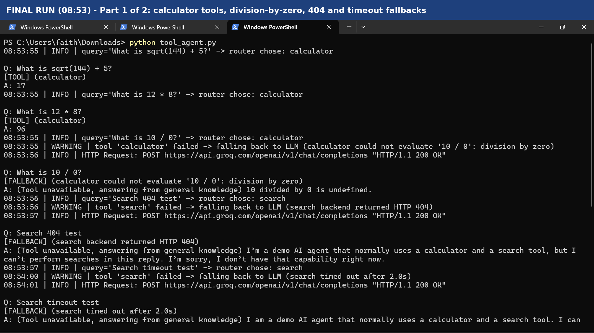
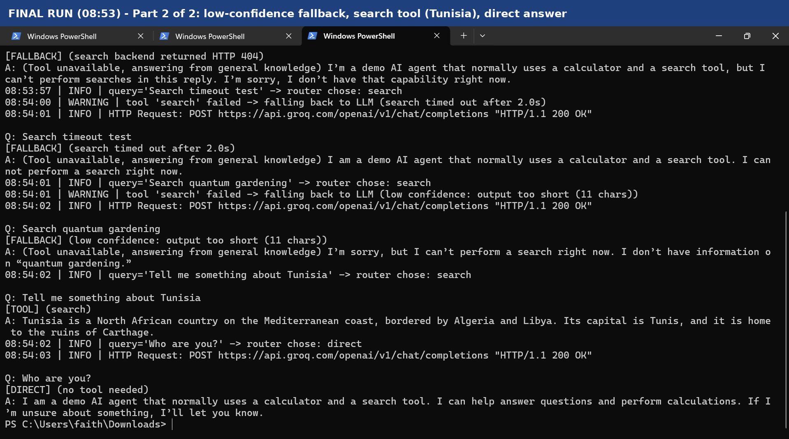
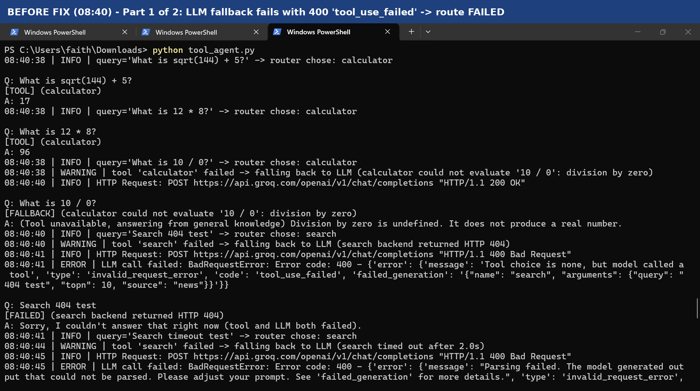
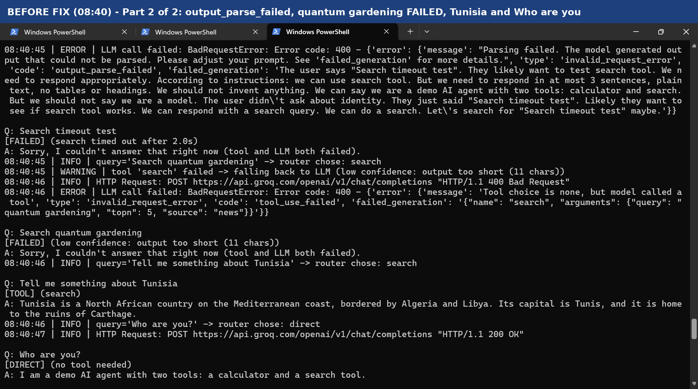

# Tool-Using Agent with Fallback Logic

A small Python agent that picks between a calculator tool, a search tool, and direct LLM reasoning. If a tool fails, times out, or returns a weak result, the agent falls back to the LLM and logs which route produced the answer.

**Author:** Faith Amanze

## How it works

- **Tools:** `calculator` (safe AST-based evaluator, supports `sqrt`, `sin`, `cos`, `log`) and `search` (simulated, with a small built-in knowledge base).
- **Router:** a rule-based `choose_route()` sends a query to the calculator, the search tool, or straight to the LLM.
- **Fallback triggers:** a tool error, a timeout (2 seconds), or low-confidence output (search result shorter than 40 characters).
- **Logging:** every answer is tagged `TOOL`, `FALLBACK` or `DIRECT`, or `FAILED` if the LLM call fails as well. Fallback answers are also prefixed with a note that the tool was unavailable.
- **LLM:** Groq (`openai/gpt-oss-20b` by default). Without an API key the script uses an offline stub so it still runs.

## Run it

```bash
pip install groq
export GROQ_API_KEY=your-key        # PowerShell: $env:GROQ_API_KEY="your-key"
python tool_agent.py
```

Optional: set `GROQ_MODEL` to use a different Groq model.

## Test queries

| Query | Expected route |
|---|---|
| What is sqrt(144) + 5? | TOOL (calculator) |
| What is 12 * 8? | TOOL (calculator) |
| What is 10 / 0? | FALLBACK (calculator error) |
| Search 404 test | FALLBACK (search error) |
| Search timeout test | FALLBACK (timeout) |
| Search quantum gardening | FALLBACK (low confidence) |
| Tell me something about Tunisia | TOOL (search) |
| Who are you? | DIRECT |

## Final test run





## Skill check

### Why is fallback logic essential for real-world AI agents?

Tools fail in real systems: APIs go down, time out, or return nothing. Without a fallback, the user gets an error. With one, the agent still answers using the LLM, as mine did on the 404 and timeout tests. The trade-off is that fallback answers are less reliable, so my agent logs the route (`TOOL`, `FALLBACK` or `DIRECT`) and labels fallback answers.

### Can you add a confidence-based fallback?

Yes. If the search output is shorter than 40 characters, my agent treats it as low confidence and falls back to the LLM. "Search quantum gardening" triggered it, because the search returned only "No results." (11 characters). The weakness is that length is a crude signal, and a relevance score would be better.

## Note

The search tool is simulated, using a small built-in knowledge base, so the 404, timeout and "No results." cases are triggered by design rather than by a live search service.

## Before the fix

An earlier run, before I corrected the LLM prompt. My prompt told the model it had a search tool, so it tried to call one, Groq rejected the call with a 400 error, and the agent returned the `FAILED` route instead of crashing. I fixed this by telling the model it cannot call tools in the fallback reply.




